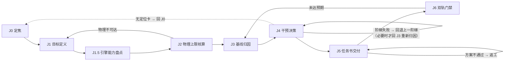
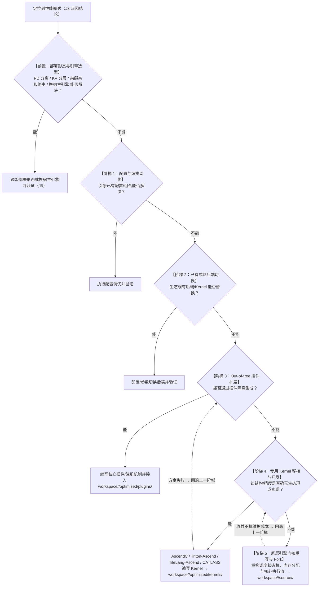

# 01 · 决策流水线与物理账本（昇腾版）

> **定位**：J0→J6 决策流水线全景、J2 双约束物理账本（核心公式）、J4 干预五阶梯 ROI 树。
> **配套**：[门禁规则](../gates/README.md) ｜ [任务书模板](../templates/task-spec-template.md) ｜ [诊断 SOP](02-ascend-diagnosis-sop.md) ｜ [硬件与引擎](03-ascend-hardware-and-engines.md) ｜ [技能目录](04-skill-catalog-and-maintenance.md) ｜ [案例库与台账规范](05-case-library-and-ledger.md)
> **适用硬件**：昇腾 **910B3（A2/A3）** 与 **950PR/950DT（A5/arch35）**；评测机主机事实（登录方式 / 卡型 / HBM / 工具版本）记录在各场景台账 `workspace/<scenario-id>/ledger/00-probe.md` 的机器档案段（不入库）。

---

## 1. J0→J6 流水线全景

### 1.1 阶段总览

| 阶段 | 输入 | 产出物 | 门禁 / 出口条件 | 回边 |
| :--- | :--- | :--- | :--- | :--- |
| **J0 定焦** | 目标=收窄到**一个**瓶颈或约束点；前置=场景台账 `00-probe.md` 的齐备性通过 | 定位卡 | 判据=**硬出口四条件全满足**（`docs/06 §6`） | `J4/J5 无定位卡 → 回 J0` |
| **J1 目标定义** | **围绕已定焦瓶颈**冻结四维度：硬件上下文 / 模型结构特征向量 / 负载分布 / SLO 与目标指标 | 冻结的「目标定义卡」（4 维度，见 §2，落 `02-scope.md`） | 四维度齐全且无争议 | — |
| **J1.5 引擎能力盘点** | 目标定义卡 + 引擎源码（`workspace/<scenario-id>/source/*`） | **gap 清单**（见 §3）；接入冒烟 + 黄金参考在 J2 之后、J3 之前执行 | gap 逐项落到五阶梯某一级 | J1 特征提取有误 → 回 J1 |
| **J2 物理上限核算** | 目标定义卡 + 硬件规格表 + 本机校准 | 双约束账本：`P_eff` / `BW_eff` / `B*` / 显存账本 / 时间下界 | 结果可复算、口径唯一 | **物理不可达 → 回 J1 重谈 SLO** |
| **J3 基线归因** | 双约束账本 + 接入冒烟通过 + J3.0 配置粗扫 | 可信基线 + 多维度瓶颈分解（L1–L4） | 总耗时可映射到明确归因类别（不设固定百分比） | 归因到默认配置瓶颈 → 先做 J3.0 粗扫 |
| **J4 干预决策** | 基线归因 + gap 清单 | **ROI 决策**（五阶梯 + 并列三选项） | 收益/成本可量化、可回退 | 阶梯失败 → **回退上一阶梯** |
| **J5 任务书交付** | ROI 决策 + 基线数据 | 两阶段任务书（方案评审 → 实现自测），五不准红线 | 架构师评审通过；门禁所有权分离 | 方案不通过 → 返工 |
| **J6 双轨门禁** | 任务书 + 实现 + 基线 | 验收结论（轨道 A 正确性 + 轨道 B 性能/稳定性） | 双轨全过、探索态→验收态 | **未达预期 → 回 J3 重新归因** |

### 1.2 回边拓扑



> **纪律**：J1.5 的接入冒烟 / 黄金参考在 J2 **之后**、J3 **之前**执行——J2 仅需 config 与硬件规格即可纸面核算；若 J2 已证明目标物理不可达，应在投入任何接入成本之前先回 J1 重谈 SLO。

### 1.3 J0→J6 ↔ 台账文件对应

每个阶段写哪个台账文件（细则以 [docs/05 §3](05-case-library-and-ledger.md) 为唯一权威）：

| 阶段 | 写哪个台账文件 |
| :--- | :--- |
| **J0 定焦** | `workspace/<scenario-id>/ledger/01-triage.md`（三环记录 + 定位卡） |
| **J1 目标定义** | `workspace/<scenario-id>/ledger/02-scope.md`（目标四输入） |
| **J1.5 引擎能力盘点** | `workspace/<scenario-id>/ledger/02-scope.md` 的 **gap 段** |
| **J2 物理上限核算** | `workspace/<scenario-id>/ledger/03-baseline-ledger.md` |
| **J3 基线归因** | `workspace/<scenario-id>/ledger/iterations/it-NNN.md`（前置：`00-probe.md` 的机器档案与齐备性检查） |
| **J4 干预决策** | 产出落 `workspace/<scenario-id>/optimized/` 或 `source/` |
| **J5 任务书交付** | 任务书（[模板](../templates/task-spec-template.md)）+ 产出在 `workspace/<scenario-id>/optimized/` |
| **J6 双轨门禁** | `04-freeze-and-gate.md` + `summary.md` + 沉淀条目 `cases/<entry-id>.md` |

---

## 2. J1 上下文冻结（四维度）

J1 在 **J0 定焦之后**执行；只冻结**与焦点相关**的维度，无需全量普查。

| 维度 | 必须冻结的内容 | 昇腾侧要点 |
| :--- | :--- | :--- |
| **硬件上下文** | 芯片代际（910B3 / 950PR / 950DT）、当前精度理论峰值与可达上限、HBM 容量与带宽、卡间拓扑（RoCE / HCCS / PCIe）与跨 NUMA 位置 | 单机 8 卡：`npu-smi info` 确认 8 卡健康、`npu-smi info -t topo` 确认卡间拓扑（HCCS / RoCE / PCIe）（本机 HBM 容量/带宽与工具版本见场景台账 00-probe.md 的机器档案段） |
| **模型结构特征向量** | 注意力族（MHA/GQA/MLA/线性稀疏）、核心几何（H、n_h、n_kv、d）、前馈形态（Dense / MoE：E、K、共享专家、门控）、数值格式（BF16 / FP8 / HiF8 / MXFP4 / MXFP8，Scale 粒度）、外部结构（Engram、MTP） | 950 新增 **HiF8 / MXFP4 / MXFP8** 原生数据类型；910B3 仅有 INT8/FP16/BF16 与低比特量化路径（msmodelslim / ATB 量化解码） |
| **负载分布** | 序列长度 P50/P95/P99（S_in / S_out）、并发与到流模式（Batch=1 / 32 / 128、均匀 vs 突发）、前缀重合率 | 前缀命中率高 → 在 J4 前置选项里优先考虑前缀亲和路由 / KV 分层（Mooncake / LMCache 昇腾适配层） |
| **SLO 与目标指标** | TTFT 上限（ms）、TPOT 上限（ms/token）、SLO 达标下 Goodput（RPS 或 tok/s）、探索态 vs 验收态目标 | 门禁以 `P_eff` / `BW_eff` 为分母；验收目标来自 J2 下界而不是拍脑袋 |

---

## 3. J1.5 引擎能力盘点与 gap 清单

**产出物形式**：`workspace/<scenario-id>/ledger/02-scope.md`（内嵌 J1.5 gap，不入库），一张表逐项登记（条目沉淀规范见 [docs/05](05-case-library-and-ledger.md)）：

| 组件 | 引擎现状（支持 / fallback / 缺失） | 需改动 | 源码落点 | 对应阶梯 |
| :--- | :--- | :--- | :--- | :--- |
| 模型定义与权重名映射 | 同族实现可复用 / eager 降级 | `register_model` | `workspace/<scenario-id>/source/vllm-ascend/`、`workspace/<scenario-id>/source/vllm/` | 3/4 |
| 注意力后端 | 头维 / KV 形态是否被 FIA/ATB 覆盖 | `register_backend` / `AttentionBackend` | `workspace/<scenario-id>/source/vllm/`（v1/attention/backends） | 2/3 |
| 量化配置 | 量化格式是否有对应 `QuantizationConfig` | `register_quantization_config` | `workspace/<scenario-id>/source/vllm/` | 3 |
| tokenizer / chat template / RoPE scaling | 就绪 / 缺失 | config 级 | `workspace/<scenario-id>/source/<engine>/` | 1 |
| MoE 路由 / 共享专家 / GMM | 引擎内置 vs 需融合算子 | torch_npu 融合算子替换 | `workspace/<scenario-id>/source/vllm-ascend/`（ops/） | 2/4 |
| 量化 scale 布局 / 低比特路径 | 910B3 走 ATB 量化解码；950 走 MXFP | msmodelslim 导出 | `repos/refs/msmodelslim/`（只读） | 3 |

> **fallback 识别**：当前不支持时引擎走的降级路径（eager / naive attention / CPU offload）的耗时**不是**架构瓶颈，不得作为 J2/J3 的基线。
> **独立黄金参考**：必须引入 transformers eager（fp32/fp64）比对 logits 与 token 序列；「改造前后对比」只能证明「没变」，不能证明「对」。

---

## 4. J2 双约束物理账本（本文件核心）

### 4.0 两把尺子：理论峰值 vs 可达上限

| 标尺 | 含义 | 获取方式 | 用途 |
| :--- | :--- | :--- | :--- |
| **理论峰值** `P_peak` / `BW_peak` | 厂商规格上限 | 硬件规格表（910B3 / 950 规格） | 仅量级判断与对外口径，**不得**作利用率判据 |
| **可达上限** `P_eff` / `BW_eff` | **本机实测**可达 | 大 GEMM 微基准得 `P_eff = α·P_peak`；大 copy 微基准得 `BW_eff = β·BW_peak` | 所有 MFU / 带宽利用率阈值与验收目标的**唯一基准** |

**军规**：任何「利用率低于 X%」的异常判定，分母必须是 `P_eff` / `BW_eff`。以理论峰值为分母，会把编译器（毕昇 / AKG）与库（CANN ACLNN / ATB）的正常效率损耗误判为「引擎缺陷」，直接诱发错误的干预阶梯选择。

**口径分工**：J0 定焦用**粗口径**估值（α≈0.65 / β≈0.70）只判算/访存；**本文的精校准只对焦点相关维度执行**，且**粗口径不得用于 J6 门禁**。

**本机校准方法（910B3，昇腾工具）**：

```bash
# 1) 算力可达上限 P_eff：CANN 大 GEMM（BF16/FP8），msprof 采算子耗时
#    用 ACLNN Matmul 或 ATB GEMM 起 8192x8192 级别大方阵，跑 100 轮取稳态
#    P_eff = FLOPs / T_msprof_op；α = P_eff / P_peak
msprof op --output=/tmp/gemm_calib --application="python3 calib_gemm.py"

# 2) 带宽可达上限 BW_eff：AscendC / ACLNN 大块 copy（HBM 往返，buffer ≥ 512MiB）
#    BW_eff = (读+写字节) / T_msprof_op；β = BW_eff / BW_peak
msprof op --output=/tmp/copy_calib --application="python3 calib_copy.py"

# 3) 通信可达基线：hccl_test（对应 nccl-tests），busbw 落盘存档
all_reduce_perf -b 8 -e 1G -f 2 -g 8   # 与同拓扑基线比，不对理论值比

# 4) 健康检查与锁频：npu-smi info（温度/功耗/健康）、npu-smi set 锁时钟
npu-smi info
npu-smi set -t clock -i 0 -c 0 --value 1500   # 锁频后多轮数据才可比
```

> 校准结果存档为 `workspace/_shared/calibration.md`（跨场景共享、不入库，按 `<模型>@<硬件>` 分节；含 α / β / 锁频命令 / CANN↔torch_npu↔PyTorch↔驱动配套版本）；**换 CANN / torch_npu / 芯片版本必复测**（见 [技能目录 §维护](04-skill-catalog-and-maintenance.md)）。

### 4.1 参数口径（Dense 与 MoE 必须分开）

- `N_total`：全量参数量；`N_card`（每卡驻留参数量）：Dense 为 `N_total/TP`，MoE 为 `N_dense/TP + N_shared/TP + ΣN_experts/EP`——**不得**简化为 `N_total/(TP·EP)`。权重静态显存按 `N_card` 算。
- `N_active`：单 token 前向实际参与计算量。Dense 时 `N_active = N_total`；MoE 时 `N_active = N_dense + N_shared + (K/E)·ΣN_experts`（K 激活专家数、E 专家总数）。
- **凡计算量 / 时间下界一律用 `N_active`；凡权重显存一律用 `N_card`。** 把 MoE 的 Prefill 计算量按 `N_total` 计，会高估一至两个数量级。
- 派生量：`W_active_bytes = N_active × bytes`；`M_weight_card = N_card × bytes`（单卡量）；`KV_read_bytes = Σ_i KV_bytes_i`（Decode 每步读取的全历史 KV）；`KV_write` = Prefill 写入的 KV 字节。

### 4.2 静态显存与并发容量账本

**权重静态显存**：

$$M_{\text{weight}} = N_{\text{card}} \times \text{每参数字节宽}$$

量化下须精确计入 Scale / Zero-point（如 MXFP4 每 32 元素一组 E8M0 scale；950 的 MXFP4/MXFP8 路径按 block-wise 计）。

**单 Token KV Cache 显存**（L 层数、n_kv KV 头数、d 单头维度、bytes 元素字节）：

| 注意力族 | 公式 |
| :--- | :--- |
| 标准 MHA / GQA | `KV_bytes/token = 2 × L × n_kv × d × bytes`（因子 2 = K、V 两份） |
| MLA 压缩潜变量 | `KV_bytes/token = L × (d_latent + d_rope) × bytes` |
| 线性 / 状态空间注意力 | `state_bytes/seq = L × n_h × d_k × d_v × bytes`（**每序列固定**开销，与 token 数无关） |

**系统可用 KV 池与最大理论并发**：

$$M_{\text{kv\_pool}} = M_{\text{total\_gpu}} - M_{\text{weight\_card}} - M_{\text{ctx}} - M_{\text{hccl}} - M_{\text{runtime}} - M_{\text{activation\_peak}} - M_{\text{graph\_pool}}$$

$$\text{Max Concurrent Tokens} = \frac{M_{\text{kv\_pool}}}{\text{KV\_bytes/token}}$$

> **易忽略项（账本误差 >10% 的主因）**：`M_ctx`（昇腾算子上下文，约 0.5~1GB/卡）、`M_hccl`（HCCL 通信缓冲）、`M_activation_peak`（Prefill 峰值激活）、`M_graph_pool`（`npugraph_ex` / TorchAir 图池预分配）。Paged 分配按 `block_size` 向上取整（含 block table 与页内碎片），短序列高并发下显著低于理论值。

**TP / EP 分片规则（每卡账本）**：

| 并行 | 规则 |
| :--- | :--- |
| TP | 权重按张量维切分；KV 头数按 TP 切分（`n_kv` 需被 TP 整除，否则复制），每卡 KV = `KV_bytes/token ÷ TP`（或按复制因子修正） |
| EP | 只切 MoE 专家权重，每卡 `M_weight = (N_dense/TP + N_shared/TP + ΣN_experts/EP) × bytes` |

### 4.3 算术强度与 Roofline 判据

- 算术强度：`AI = FLOPs / Bytes`（FLOP/Byte）。
- 可达平衡点：`B* = P_eff / BW_eff`（与 §4.4/4.5 的 `max()` 交叉点同口径）。厂商口径 `B*_peak = P_peak / BW_peak` 仅作量级参考、不作判据。
- 判据：`AI > B*` → **算力受限**；`AI < B*` → **访存受限**。

| 阶段 | `AI` 近似 | 主导区间 |
| :--- | :--- | :--- |
| Decode | `AI ≈ 2·N_active·Batch / (W_active_bytes + KV_read_bytes)` | 小 Batch → 访存受限；大 Batch / 短上下文 → 算力受限 |
| Prefill | `AI ≈ FLOPs_pre / (W_active_bytes + KV_write)` | 短序列 / 小模型 → 可能访存受限；长序列 → 算力受限 |

> `B*` 随精度变化（910B3 走 FP8/低比特、950 走 MXFP4/MXFP8 时 `P_eff` 更高，`B*` 上升），判据与下界必须与**当前精度**一致。

### 4.4 Decode 单步时间下界

$$\text{Data Per Step} = W_{\text{active\_bytes}} + \sum_{i=1}^{\text{Batch}} \text{KV\_bytes}_i$$

$$T_{\text{step\_min}} = \max\!\left(\frac{\text{Data Per Step}}{BW_{\text{eff}}},\ \frac{2 \cdot N_{\text{active}} \cdot \text{Batch}}{P_{\text{eff}}}\right)$$

小 Batch / 长上下文时访存项主导；大 Batch 时访存项被摊薄、计算项主导——此时「实测耗时高于访存下界」是正常现象，**不得**据此判定「带宽利用率低」。

### 4.5 Prefill 单次时间下界

$$\text{FLOPs\_pre} \approx 2 \cdot N_{\text{active}} \cdot S_{in} + 2 \cdot L \cdot n_h \cdot d \cdot S_{in}^2$$

$$T_{\text{prefill\_min}} = \max\!\left(\frac{\text{FLOPs\_pre}}{P_{\text{eff}}},\ \frac{W_{\text{active\_bytes}} + \text{KV\_write}}{BW_{\text{eff}}}\right)$$

- 计算量项用 `N_active`（MoE 不为 `N_total`）；长上下文下 `S_in²` 项权重急剧上升。
- 二次方项 `2·L·n_h·d·S_in²` 为**因果（下三角）**口径；满矩阵为 `4·L·n_h·d·S_in²`。仅对 MHA / GQA 成立；**MLA / 线性注意力 / 稀疏注意力必须替换为各自计算量表达式**（MLA 走低秩投影 + 吸收态；线性注意力约 `O(S_in·d²)`）。

### 4.6 利用率口径（分母唯一）

- 相对理论（仅对外口径）：`MFU_peak = 理论最少 FLOPs / (T_actual × P_peak)`。
- **相对可达（判据用）**：`MFU_eff = 理论最少 FLOPs / (T_actual × P_eff)`。
- 有效带宽利用率：`BW_util = Data Per Step / (T_actual × BW_eff)`。
- 口径注：`P_*` / `BW_*` 用 SI 基单位（FLOP/s、B/s）；规格表写成 TFLOPS/TB/s 须 ×10¹² 后再代入。
- 测量铁律：`T_actual` 一律来自 **`msprof` / `msprof op`** 的设备侧时间戳（详见 [诊断 SOP §度量纪律](02-ascend-diagnosis-sop.md)）；`time.time()` / `torch.npu.Event` / `do_bench` 因含 Host 开销**绝对不可用**。

---

## 5. J4 干预五阶梯 ROI 树

> **前置**：J4 的前置是**定位卡**（`01-triage.md`）；无定位卡不得进入 J4/J5。

### 5.1 决策树（升级 / 回退路径）



> **排序原则**：按 **ROI（预期收益 ÷ 引入成本）从高到低**尝试，优先可逆、不破坏主干升级能力的方案。**不要以阶梯序号代替收益排序**——按序号走会错失「低成本高收益」选项。

### 5.2 与五阶梯并列的三个选项（必须纳入决策）

1. **调整部署形态或换宿主引擎**：PD 分离、KV 分层 / 远端缓存（Mooncake / LMCache 昇腾适配层）、前缀亲和路由，或更换引擎（vllm-ascend / MindIE-LLM·Motor / xLLM / SGLang-Ascend）。瓶颈来自编排而非算子时，收益常远大于定制 Kernel。
2. **修订 SLO / 降目标**：J2 已证明目标物理不可达（或代价远超收益）时，正确做法是回 J1 重谈 TTFT / TPOT / Goodput，而不是硬扛。
3. **不优化**：当前已达标时，任何改动都只是新增风险与维护负担。

### 5.3 五阶梯判别标准表（昇腾化）

| 干预阶梯 | 适用场景与判别条件 | 典型手段示例（昇腾侧） | 引入成本 | 维护风险 |
| :--- | :--- | :--- | :--- | :--- |
| **阶梯 1：配置与编排调优** | 算法与算子均成熟，瓶颈来自参数不匹配或拓扑规划失误 | 调 TP/EP 规模、`max_num_batched_tokens` / `max_num_seqs`、KV dtype（BF16/FP8）、chunked prefill、`npugraph_ex` / TorchAir 图捕获分桶 | 极低（小时级） | 零 |
| **阶梯 2：已有成熟后端切换** | 引擎内置多种后端，默认后端非当前硬件最优 | 切换 Attention 后端（FIA / ATB 融合算子 / ACLNN 单算子）、切换量化解码路径（ATB 低比特 / msmodelslim 导出权重的加载路径） | 低（天级） | 极低 |
| **阶梯 3：Out-of-tree 插件扩展** | 需支持新量化格式、外部记忆表或非标模型结构，引擎支持插件 | vllm-ascend / vLLM 的 `register_quantization_config`、`register_model`、`register_backend`；`workspace/<scenario-id>/optimized/plugins/` 独立解耦包 | 中（数天） | 低（不破坏引擎主干升级能力） |
| **阶梯 4：专用 Kernel 移植与开发** | 全新结构（非标头维 MLA、长线性注意力）、或目标代际缺失原生指令 | AscendC / Triton-Ascend / PyPTO / TileLang-Ascend / CATLASS 编写 Fused 算子（RoPE/KV write/QK Norm/MoE GMM/MLA absorb）；前沿 Kernel 向 A2A3 / A5 移植；落 `workspace/<scenario-id>/optimized/kernels/` | 高（1~2 周） | 中（精度与多代际分支持续维护） |
| **阶梯 5：底层引擎内核重写与 Fork** | 引擎控制面延迟过高（Python 瓶颈无法根除）、或调度模型与架构不兼容 | 调度状态机下沉、重写内存管理与 HCCL 通信流；必须改引擎时落 `workspace/<scenario-id>/source/<engine>/` 并走 `export-patch` 导出 | 极高（月级） | 极高（脱离社区主干，背负沉重包袱） |

**回退规则**：阶梯是「尝试顺序」而非「单向阶梯」。阶梯 4/5 尝试失败后必须回退到上一阶梯（并在 `workspace/<scenario-id>/ledger/`（台账）留痕），不得因已投入成本继续加码。

**源码落点对照**：阶梯 3 → `workspace/<scenario-id>/optimized/plugins/`；阶梯 4 → `workspace/<scenario-id>/optimized/kernels/`；阶梯 2/4/5 必须改引擎 → `workspace/<scenario-id>/source/<engine>/`（改后用 `bash scripts/manage_repos.sh export-patch <engine> --scenario <scenario-id>` 导出补丁到 `workspace/<scenario-id>/ledger/patches/`，不入库）；只读参考 → `repos/refs/<repo>/`（严禁修改）。落点与交付物规范见 [docs/05](05-case-library-and-ledger.md)。

---

## 6. 阶段产出物与回边速查

| 场景 | 动作 |
| :--- | :--- |
| J6 未达预期 | 回 **J3** 重新归因（可能是归因错或收益没兑现，不是简单重试） |
| 阶梯 4/5 尝试失败 | 回退**上一阶梯**并留痕（PMR 日志） |
| J2 物理不可达 | 回 **J1** 重谈 SLO（或走「修订 SLO」选项） |
| J3 归因到默认配置瓶颈 | 先做 J3.0 配置粗扫，把「最佳已知配置」固化为基线 |
| 改造涉及共享路径 | J6 轨道 B 回归抽检 ≥1 Dense + 1 MoE + 1 长上下文 |

---

## 阶梯 4 实操：算子开发与审查（AscendC / Triton-Ascend / TileLang / CATLASS）

针对 J4 阶梯 4「专用 Kernel 移植与开发」的算子实现、审查与交付。动手前必读 [AGENTS.md](../AGENTS.md) §5 五不准红线与 [任务书模板](../templates/task-spec-template.md)（两阶段交付、方案评审先行）。参考实现一律读 `repos/refs/<repo>/`（只读），交付落 `workspace/<scenario-id>/optimized/kernels/`；**环境与配套版本事实见场景台账 00-probe.md 的机器档案段**（本机 CANN / torch_npu / 驱动版本）。

### 1. 读参考实现（J4 前先读再算）

在 `repos/refs/` 找同结构参考（数据布局、向量化载入、Tiling 逻辑）；先 `bash scripts/manage_repos.sh clone <name>`（**refs 不需 `--scenario`**）。

**完成标准**：能说出参考实现的 UB/Tile 划分与边界处理，并明确本次定制的差异点（否则不应启动阶梯 4）。

### 2. UB 预算核算

按 910B 的 `16 group × 3 × 4KB = 192KB/核` 规划 Tile：主算 Buffer + 双缓冲 + 标量/搬数 buffer 合计**不得超过 192KB/核**；非整除 Tile 必须预留边界处理（mask/拷贝）。**950 为 `8 group × 2 × 16KB`，Bank 冲突规则重写，不得沿用 910B 规划**（950 场景先仿真 cannsim 再上真机）。

**完成标准**：写出「输入 Buffer + 输出 Buffer + 双缓冲副本 + 临时」的字节账目，总占用 ≤ 192KB/核且有安全边际。

### 3. 选型 DSL

| 候选 | 适用 | 要点 |
| :--- | :--- | :--- |
| **AscendC** | 底层算子、达芬奇 Cube/Vector 异构模型 | 双缓冲流水、`__ubuf__` 组织、精度与边界显式控制 |
| **Triton-Ascend** | 从 Triton 迁移/快速原型 | **`num_warps` / `num_stages` 在昇腾不可用**（无对应语义，误设不生效或报错）；核类型须匹配 |
| **TileLang-Ascend** | 高级 Tile 编程、编译器 Pass 直达 | 仓库分支 `ascendc_pto`（`workspace/<scenario-id>/source/tilelang-ascend/`）；`tilelang-perf-optimization` 强制 `msprof op` 度量 |
| **CATLASS** | 矩阵乘模板库 | **非 CUTLASS 移植**（达芬奇 Cube/Vector 异构模型不同） |

**完成标准**：选定一种并给出理由（结构匹配/生态成熟度/维护成本），在任务书中声明落点。

### 4. 编码与 P0-P2 自查

| 级 | 内容 | 处置 |
| :--- | :--- | :--- |
| **P0** | 非整除 Tile 下 `mask=` 缺失/错位导致越界或静默错值；访存偏移越界 | 零容错，直接打回 |
| **P1** | 低精度累加（`tl.sum(x_fp16)` 默认保持输入精度，必须 `tl.sum(x.to(tl.float32))`）；核类型错配；热路径隐式同步 | 必须修 |
| **P2** | 双 pass 反模式（可慢 5×）、Tile/wave 量化、UB 流水编排、`num_warps` / `num_stages` 误用 | 建议修（性能向） |

**完成标准**：P0 项零残留；P1/P2 项全部说明处置；五不准红线未命中（AGENTS.md §5）。

### 5. mssanitizer 检查

```
mssanitizer --check=memcheck,racecheck,initcheck,synccheck --output=/tmp/san <运行命令>   # 子命令参数以 --help 为准，须上机核实
```

**完成标准**：memcheck（越界/未初始化）/ racecheck（数据竞争）/ initcheck（初始化顺序）/ synccheck（同步语义）四项通过或问题清单清零。

### 6. 交付物：test_op.py + benchmark_op.py

- `test_op.py`：覆盖规整 shape + 非对齐边界 shape（非 128 对齐、Batch=1、极端短/长序列）；余弦 + 最大/相对误差**双指标**，阈值按 [门禁规则](../gates/README.md) L2 档。
- `benchmark_op.py`：用 `msprof op` 出微基准与 UB/带宽利用率，对比基线加速比（口径见 [诊断 SOP §2.1](02-ascend-diagnosis-sop.md)）。

**完成标准**：L2 双指标在噪声底内；`msprof op` 报告有效带宽/加速比；J6 轨道 B 按 [门禁规则](../gates/README.md) 验收。

### 关键命令与判定表

| 主题 | 命令/工具 | 判定 |
| :--- | :--- | :--- |
| 算子微基准 | `msprof op --output=<dir> --application="python3 benchmark_op.py"` | 报耗时/有效带宽/加速比 |
| 审查分级 | — | P0 零容错；P1 必须修；P2 建议修 |
| 精度门禁 | `torch.testing.assert_close(actual, expect, rtol=..., atol=...)` | 余弦 + 最大/相对误差双指标 |
| 越界/竞争 | `mssanitizer --check=memcheck,racecheck,initcheck,synccheck` | 四项通过 |

### 常见坑

1. **`num_warps` / `num_stages` 在昇腾不可用**：这两个 Triton 参数在 Ascend 路径无对应语义，误设不生效或报错；改用 AscendC 双缓冲/Tile 参数表达流水。
2. **核类型错配**：算子被分派到错误的核（Cube vs Vector），性能断崖式下降——审查 kernel 声明与调用处的核类型匹配。
3. **归约升精度缺失**：`tl.sum` / `tl.reduce` 对 fp16/bf16 输入默认保持输入精度累加（红线 4），必须显式 `tl.sum(x.to(tl.float32), axis=...)`；`tl.dot` 默认 fp32 累加无此问题。
4. **双 pass 反模式**：同一数据流拆成两个 kernel 反复读写 HBM，实测可慢 5×——优先垂直融合为单次 launch。
5. **把 910B 的 UB/Bank 规划平移给 950**：950 是 `8 group × 2 × 16KB`，Bank 冲突规则重写；950 场景先仿真（cannsim 仅支持 950）再上真机。
6. **访存边界只测规整 shape**：红线 5（测试弱化）；必须覆盖非 128 对齐、Batch=1、极端短/长序列。

---

## J6 实操：量化与门禁（msmodelslim + L1/L2/L3 + 探索态/验收态）

J6 双轨门禁的昇腾落地：轨道 A 正确性（L1/L2/L3 三级）+ 轨道 B 性能（探索态/验收态）。**门禁脚本/阈值/基线由架构师持有并对 Agent 只读**（[门禁规则](../gates/README.md)）；Agent 只交实现与自测，不得改门禁。量化/性能结论**硬绑定环境**——换 CANN / torch_npu / 芯片（910B3 vs 950）必须重跑校准与复测（本机配套版本见场景台账 00-probe.md 的机器档案段）。

### 1. msmodelslim 量化流程

- `model-adapt`：模型接入与算子适配（HF/本地模型 → 昇腾量化可处理形态）。
- `evaluate`：量化门禁——目标值 + 容差判定，**禁止改评测口径**，0 分自愈链。
- `tuning`：自动量化调优（档位搜索 + EP 并行）。

参考底座 `repos/refs/msmodelslim/`（只读，先 `bash scripts/manage_repos.sh clone <name>`，**refs 不需 `--scenario`**）。

**完成标准**：导出量化权重（含 scale/zero-point 齐全）；`evaluate` 在目标容差内通过；`tuning` 记录档位与 EP 并行配置。

### 2. 定级门禁路径（先定路径再定阈值）

| 路径 | 门禁档 | 说明 |
| :--- | :--- | :--- |
| 融合 / 重排 / 平替 Kernel（数学等价） | **L1 逐位一致** | 同配置重跑逐位比对（含跨配置 md5 抽查） |
| 单算子级 / 引擎等价替换（bf16/fp16/fp8 基准） | **L2 数值门** | 余弦 + 最大/相对误差**双指标并用** |
| 量化 / KV 压缩（有损） | **L3 有损门** | 下游任务误差预算制，禁「零误差」标准 |

阈值语义与容差表见 [门禁规则](../gates/README.md) 二；**完成标准**：明确当前改动落 L1/L2/L3 哪一档，并在任务书/门禁记录中声明判据。

### 3. L2 数值门执行

```
torch.testing.assert_close(actual, expect, rtol=..., atol=...)   # 按 dtype 理论浮点容差设定
```

**完成标准**：余弦相似度 + 最大/相对误差**双指标并用**（余弦对整体幅度不敏感，**不可单用**）；改造后落在「正确实现相对 golden 的偏差噪声底」内。

### 4. L3 有损门执行（评测工具）

用 evalscope（或 AISBench）打 vllm-ascend 的 OpenAI 兼容端点评测 MMLU / GSM8K：evalscope 可打任意 OpenAI 兼容端点（vllm-ascend 直接可用）；AISBench 为昇腾官方评测；具体子命令以当前版本为准，须上机核实。

**完成标准**：任务阈值按**任务与评测噪声**校准（多次运行 + 置信区间），不用「综合得分掉点 ≤ 1.0%」这类跨任务一刀切；**禁止「零误差」标准**。

### 5. 探索态 → 验收态（轨道 B 性能门禁）

- **探索态**：开发分支快速迭代，同窗 A/B（同并行度 / 同 batch / 同 shape / 同图分桶）验证方向；数据**不得入库**。
- **验收态**：冻结环境（版本快照）+ 门禁在干净容器/CI 独立执行，固定权重/数据集；附从零复现命令；**通过后才允许入库**。

**完成标准**：相对基线收益 ≥ 预估收益 80%（禁止 J2 物理下界作分母）；开环负载 Goodput 达标（P95 TTFT/TPOT）；验收态报告与版本快照随过程留痕归档 `workspace/<scenario-id>/ledger/`，入库形态为条目 md §5（规范见 [docs/05](05-case-library-and-ledger.md)）。

### 6. 环境硬绑定复测

记录 CANN / torch_npu / PyTorch / 驱动 / 引擎 commit 快照；任何一项变更后重跑校准与门禁。

**完成标准**：版本快照与门禁结果随报告归档；「换台机器跑不出同样结果」即未通过。

### 关键命令与判定表

| 检查项 | 工具/命令 | 判定 |
| :--- | :--- | :--- |
| 量化流程 | msmodelslim `model-adapt` / `evaluate` / `tuning` | evaluate 在目标容差内通过 |
| L1 | 同配置重跑逐位比对 | 逐位一致（不要求长生成 100% 逐字吻合作硬门禁） |
| L2 | `torch.testing.assert_close` | 余弦 + 最大/相对误差双指标在噪声底内 |
| L3 | evalscope / AISBench 评测 MMLU / GSM8K | 任务误差预算内（按评测噪声校准） |
| 性能门禁 | `msprof op` / 压测 | 收益 ≥ 预估 80%；探索态数据不得入库 |
| 版本快照 | 记录 CANN/torch_npu/驱动/引擎 commit | 换版本必须复测 |

### 常见坑

1. **把「100% 逐字吻合」当 L1 硬门禁**：bf16 下归约顺序一变 logits 就抖 ~1e-3，长生成必现个别 top-1 翻转，该门禁不可稳定通过——L1 语义是「数学等价路径的最低档」，正确实现也可能有噪声底。
2. **L2 单用余弦**：余弦对整体幅度不敏感，必须与最大/相对误差**双指标并用**；logprob 指标用 `mean |Δlogp|` / top-k KL，不用平均相对偏差（logp 接近 0 时分母爆炸）。
3. **L3 用「零误差」或跨任务一刀切**：有损路径必须下游任务误差预算制，阈值按任务与评测噪声校准。
4. **用探索态数据入库**：只有**验收态**（冻结环境 + 干净容器独立执行 + 完整复现链）才能入库；探索态 A/B 只作参考。
5. **换版本不复测**：量化/性能结论硬绑定 CANN / torch_npu / 芯片，换任一必须重跑校准与门禁（最高风险项）。
6. **门禁脚本可被交付方改写**：所有权必须分离（架构师持有、Agent 只读）；任务书中声明门禁路径禁写。
