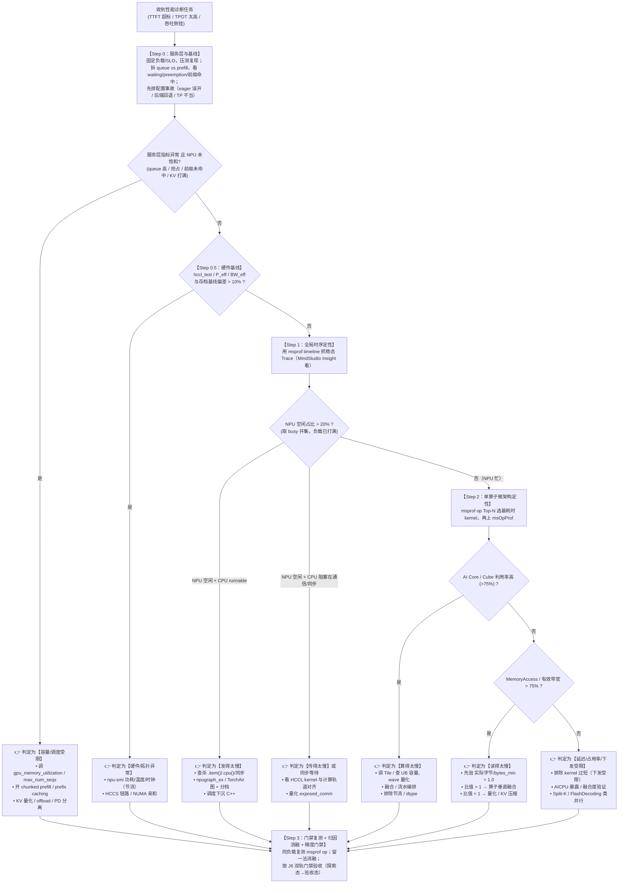

# 02 · 昇腾诊断漏斗与排障 SOP

> **定位**：L1–L4 昇腾诊断漏斗、四大瓶颈逐节定位、架构师四步排障 SOP、度量纪律。
> **配套**：[流水线与物理账本](01-pipeline-and-ledger.md)（P_eff/BW_eff 口径）｜ [硬件与引擎](03-ascend-hardware-and-engines.md) ｜ [技能目录](04-skill-catalog-and-maintenance.md) ｜ [AGENTS.md](../AGENTS.md)
> **测量铁律（全篇前提）**：**只信 `msprof` / `msprof op`**；`time.time()` / `torch.npu.Event` / `do_bench` 因含 Host 开销**绝对不可用于性能评估**。

---

## 1. L1–L4 昇腾诊断漏斗

编号是漏斗顺序（宏观在前），不是层级高低。**先量化差距，再定位瓶颈**——没有负载、SLO 与基线，任何 Profiler 结果都无法解释。

```
L1 宏观: 系统级 (System & Cluster Level)
├── npu-smi / DCMI（dcmi 工具集）──── 8 卡健康、功耗、温度、时钟、HBM 水位、HCCS/RoCE 拓扑
├── npu-exporter + Prometheus ─────── 秒级采集：NPU 利用率、显存水位、温度
├── 引擎指标 ──────────────────────── TTFT（首字延迟）、TPOT（解码延迟）、KV 使用率、前缀命中
└── 适用场景 ─────────────────────── 生产监控、秒级报警、初步定性（容量/调度 vs 算子）

L2 时序: 全局时序与调度级 (Timeline & Interaction Level)
├── msprof timeline ───────────────── 全局时间线（Host 线程、ACL 运行时、AICPU、NPU Kernel、HCCL）
├── MindStudio Insight ────────────── msprof 产物的可视化分析前端
├── torch_npu profiler ────────────── PyTorch 热路径分析、算子开销分布、下发气泡
└── 适用场景 ─────────────────────── 捕捉 CPU 下发气泡、通信与计算重叠、算子排队空隙

L3 微架构: 算子微架构级 (Kernel Micro-Architecture Level)
├── msprof op ─────────────────────── 按算子统计（耗时/占比/有效带宽），Top-N 主核
├── msOpProf（msprof 的算子深度模式）── AI Core 利用率、指令流水、Tile/UB 压力、Roofline
├── AICPU 排查 ───────────────────── 控制 CPU 算子耗时与暴露（调度/搬数/同步）
└── 适用场景 ─────────────────────── 算子融合度验证、Tile 调优、算力 vs 访存拐点分析

L4 互联: 互联与分布式通信级 (Interconnect & Collective Level)
├── HCCL（HCCL_CONNECT_TIMEOUT / HCCL_BUFFSIZE 等诊断 env）
├── hccl_test ─────────────────────── all_reduce_perf / alltoall_perf busbw 基线
├── RoCE 拓扑与 PFC 探针 ──────────── ethtool -S 查 pause 帧/PFC storm、光模块误码
├── 快慢卡三分类 ──────────────────── Host 下发慢 / 计算慢 / 通信慢（cluster-fast-slow-rank-detector）
└── 适用场景 ─────────────────────── 多卡 TP/PP/EP 扩展倒挂、MoE 长尾卡顿、PD 分离 KV 传输
```

> 引擎 metrics 是最便宜的定性入口：vllm-ascend 暴露 `/metrics`（`vllm:time_to_first_token_seconds`、`vllm:kv_cache_usage_perc`、`vllm:prefix_cache_hits/queries`），SGLang-Ascend 暴露 `sglang:cache_hit_rate` 等，Prometheus 抓取后秒级区分 Prefill / Decode / 前缀命中问题。

---

## 2. 度量纪律与硬件基线（先对齐口径，再上 Profiler）

### 2.1 测量铁律：为什么禁用 Python 侧计时

| 计时方式 | 测得内容 | 为什么不可用于性能评估 |
| :--- | :--- | :--- |
| `time.time()` | Host 墙钟 | 含 Python 解释器开销、算子**下发（launch）延迟**、同步等待；毫秒级噪声淹没微秒级算子耗时 |
| `torch.npu.Event` | Host 侧事件时间戳差 | 事件在 Host 排队，测的是「端到端含发射间隙」而非设备侧纯执行时间；**调度/图模式（npugraph_ex）下测值虚高或失真** |
| `do_bench` | Triton 系循环计时 | 面向 CUDA 生态（内部用 CUDA event），昇腾上无对应语义且同样含 Host 开销 |
| **`msprof` / `msprof op`** | **设备侧硬件时间戳 + 计数器** | AI Core/Cube/Vector 实际执行时间、有效带宽、占用率，**唯一可信口径** |

> 结论：性能评估与门禁复测一律用 `msprof op` 的算子耗时与设备侧指标；Python 侧计时最多用于「量级粗判」，**不得**进入任何阈值判定与 J6 门禁。

### 2.2 硬件基线先标定（先确认硬件正常，再谈利用率）

上 Profiler 前先确认**硬件本身没坏、分母是实测天花板**（`P_eff`/`BW_eff` 见 [物理账本 §4.0](01-pipeline-and-ledger.md)）。新机器 / 换机 / CANN 或驱动升级后跑一次存档：

```bash
# 0) 健康检查：8 卡都在、无降速、无 ECC 类告警
npu-smi info
npu-smi info -t topo                # HCCS 拓扑矩阵（确认 910B3 单机 8 卡互联形态）

# 1) 算力可达 P_eff：大 GEMM（BF16/FP8）msprof op 校准 → α = P_eff / P_peak
msprof op --output=/tmp/gemm_calib --application="python3 calib_gemm.py"

# 2) 带宽可达 BW_eff：大 copy（buffer ≥ 512MiB）→ β = BW_eff / BW_peak
msprof op --output=/tmp/copy_calib --application="python3 calib_copy.py"

# 3) 通信基线：hccl_test（对应 nccl-tests 的昇腾实现）
all_reduce_perf -b 8 -e 1G -f 2 -g 8

# 4) 锁频（与交付环境一致，多轮数据才可比）
npu-smi set -t clock -i <卡> -c <芯> --value <频率>
```

| 基线项 | 工具 | 用作哪个公式的分母 / 判据 |
| :--- | :--- | :--- |
| HBM 可达带宽 | AscendC/ACLNN 大 copy（msprof op 计时） | `BW_eff`、`BW_util`、Decode 下界 |
| GEMM 可达 TFLOPS | ACLNN Matmul / ATB GEMM（msprof op 计时） | `P_eff`、`MFU_eff` |
| HCCL busbw | `hccl_test` | 通信瓶颈判据（与同拓扑基线比） |
| Kernel 下发开销 | 空 kernel 循环 / `npugraph_ex` replay 对比 | 下发气泡拆层（§5 瓶颈 3） |
| 8 卡健康与锁频 | `npu-smi info` / `npu-smi set` | 排除节流与硬件降速 |

> 低于基线约 10% 以上 → 先查硬件（`npu-smi info` 功耗/温度/时钟、HCCS 链路、NUMA 亲和），再进入后续诊断。锁频后多轮数据才可比；不锁频的 HBM 实际带宽随功耗墙与温度显著波动。

---

## 3. 四大瓶颈逐节定位

### 瓶颈 1：算得太慢（Compute-bound）

| 维度 | 内容 |
| :--- | :--- |
| **物理特征** | 长 Prompt Prefill（大 GEMM）、大 Batch Decode；算术强度 `AI > B*`（`B* = P_eff/BW_eff`），但实际 MFU 远低于可达上限 |
| **昇腾定位工具** | `msprof op` 统计 Top-N；`msOpProf` 看 AI Core 利用率 / Cube vs Vector 分工 / 指令流水 |
| **判据阈值（P_eff 口径）** | **Prefill MFU_eff < 35% 报警**（阈值须随本机 `P_eff` 标定重定，**勿直接移植 NVIDIA 侧数值**）；Decode 天然低 MFU，不适用该阈值。先排除节流（`npu-smi` 功耗/温度触顶、频率被压）再进算子分析 |
| **定位后决策** | Cube 利用率低 → Tile/wave 量化、对齐到 64/128 元素、查 UB 容量与流水；Vector 与 Cube 串行 → 融合/流水编排（num_stages 在昇腾 Triton 路径不可用时退回 AscendC 双缓冲）；融合度不足 → 识别 torch_npu 融合算子（FIA/MLA/GMM）未生效 |

> **910B vs 950 差异**：910B 的 `PipelineExecuteUtilization` / `MemoryAccess` 是可用指标；**950 不支持这两项**，改用新增的 CCU / UB 带宽采集（见 [硬件与引擎 §代际对比](03-ascend-hardware-and-engines.md)）。

### 瓶颈 2：读得太慢（Memory-bound）

| 维度 | 内容 |
| :--- | :--- |
| **物理特征** | 单请求 / 小并发 Decode、逐元素算子（RMSNorm/RoPE/激活）、未量化长上下文 KV 检索；`AI < B*` |
| **昇腾定位工具** | `msprof op` 按算子看有效带宽；`msOpProf` 看 MemoryAccess / UB↔HBM 数据量（950 用 UB 带宽指标） |
| **判据阈值（BW_eff 口径）** | 单算子有效带宽利用率 **≥ 75%~90%** 且计算单元利用率极低 → 撞内存墙。**必须联动核对理论最小流量**：`实际字节 / bytes_min ≈ 1.0` 是真·带宽极限（唯有量化破局）；比值显著 > 1 是未融合算子冗余 HBM 往返（应做算子垂直融合），**不是硬件极限** |
| **定位后决策** | 比值 ≈1 → 低比特量化（910B3 走 ATB 量化解码 / msmodelslim；950 走 MXFP4/MXFP8）、KV Cache 压缩（FP8/低比特 KV，注意后端门控）；比值 >1 → AscendC / Triton-Ascend 垂直融合（Add+RMSNorm+RoPE+量化+Paged 写入单次 Launch）；离散 Paged KV 读取退化 → 检查 KV 布局与块大小 |

### 瓶颈 3：发得太慢（CPU-bound / 下发气泡）

| 维度 | 内容 |
| :--- | :--- |
| **物理特征** | 自回归小 Batch、超多小专家（Fine-grained MoE）路由、长对话多轮交互。NPU 执行一个算子 2~5μs，CPU 解释 + 派发 15~30μs，NPU「跑跑停停」 |
| **昇腾定位工具** | `msprof` timeline（Host 线程 / ACL 下发轨道 vs NPU Kernel 轨道）、MindStudio Insight、`torch_npu` profiler、py-spy（查 Python 侧） |
| **判据阈值** | **Bubble Ratio > 20% 为严重下发瓶颈**（优秀系统 < 5%）。Bubble = 窗口内 NPU 完全空闲时长 / 窗口总时长（取 busy 区间并集，非各 stream 相加）。**前提是负载打满**——低 QPS 下 NPU 空闲是没请求，不是发射瓶颈 |
| **定位后决策** | 查杀热路径隐式同步（`.item()` / `.cpu()` / `torch.nonzero()` / 基于张量结果的 Python if）；固化 **`npugraph_ex` / TorchAir 图** + 分档捕获（动态 Batch 用分桶，禁用频繁重捕获）；调度/准备输入/采样留在图外，step 间间隙用引擎异步调度消除；Python 瓶颈无法根除 → 阶梯 5 控制面下沉 |

### 瓶颈 4：传得太慢（Network-bound / 通信阻塞）

| 维度 | 内容 |
| :--- | :--- |
| **物理特征** | 跨卡 TP（AllReduce）、MoE EP（All-to-All）、PD 分离跨节点 KV 传输；通信与计算串行、热门专家长尾「木桶效应」 |
| **昇腾定位工具** | `msprof` timeline 看 HCCL kernel 与计算轨道重叠；`hccl_test` 实测 busbw 与同拓扑基线比；`ethtool -S` 查 RoCE PFC 反压/pause 帧；快慢卡三分类（cluster-fast-slow-rank-detector）；DeepEP→CAM 转换（`deepep-to-cam-converter`）后按 CAM 语义观测 |
| **判据阈值** | 唯一判据是**暴露时间** `exposed_comm = comm_time - overlapped_time` 在 step 关键路径的占比；「通信总耗时 > 25%」但被计算完全覆盖**不是**瓶颈。hccl_test 实测远低于同拓扑基线 → 通信层问题；路由统计显示专家倾斜 → MoE 负载问题（直接看路由统计，别只靠 rank 间耗时方差） |
| **定位后决策** | 计算通信未重叠 → micro-batch / two-batch 双流重叠；小包通信 → 攒批合并为连续大块（KV page 逐块拷贝被延迟主导，MB 级才接近峰值）；专家倾斜 → EPLB 类动态专家均衡；PFC storm（pause 帧疯跳）→ 查交换机侧 PFC 配置与 ECN，通信延迟从 μs 级飙到 ms 级 |

---

## 4. 架构师四步排障 SOP（Step 0 → 3）

接手「性能不达标」任务时按此执行，**切忌一上来改写算子**：



**Step 0（前置）**：固定模型、dtype、量化、TP/PP/EP、并发/QPS、输入输出长度，用标准压测复现；读引擎 metrics 拆 `queue + prefill`，看 `num_requests_waiting` / `kv_cache_usage_perc` / `num_preemptions` / 前缀命中；先排配置事故（`--enforce-eager`、attention backend 回退、量化未生效、TP 不当）。

**Step 0.5（硬件基线）**：先跑一次最小 `msprof op` 探针确认硬件计数器可读（防「npu-smi 看到卡但 profiler 权限缺失」的假活环境）；随后将本机 `hccl_test` / `P_eff` / `BW_eff` 与存档基线对比，偏差 >10% 先修硬件/拓扑/NUMA，不进入 Step 1。

**Step 3（门禁闭环）**：性能改动用同负载复测（`msprof op` 口径的 MFU_eff / BW_util / TTFT / TPOT，报 P50/P95/P99）；组合了多个微架构方法时必须做**留一法消融**（`attribution = ms_without_m - ms_champion > 2%` 才算归因成立）；任何算子或量化改动按 J6 轨道 A 门禁（L1 逐位一致 / L2 数值门 / L3 有损门，见 [门禁规则](../gates/README.md)）校验；不达标的收益一律回退。

---

## 5. 昇腾诊断速查矩阵（一表通）

| 瓶颈类型 | 核心直观表象 | 关键诊断指标与阈值 | 核心定位工具 | 根因分类 | 架构师战术决策 |
| :--- | :--- | :--- | :--- | :--- | :--- |
| **算得太慢<br>(Compute-bound)** | Prefill 耗时长、大并发吞吐推不动 | **Prefill MFU_eff < 35%**（Decode 不适用）<br>AI Core/Cube 利用率高<br>指令流水饱和 | `msprof op`<br>`msOpProf`<br>`torch_npu` profiler | 1. Tile/wave 量化未饱和<br>2. occupancy/UB 流水差<br>3. 节流或算法选择非最优 | 调 Tile、查 UB 容量与流水编排、排除节流与 dtype、识别融合算子未生效 |
| **读得太慢<br>(Memory-bound)** | Decode 生成缓慢、长上下文延迟暴涨 | **有效带宽利用率 ≥ 75%**<br>MemoryAccess 高且计算单元极低<br>算术强度 < `B*` | `msprof op`<br>`msOpProf` | 1. 权重全精度未量化<br>2. 中间张量反复写回 HBM<br>3. KV Cache 臃肿 | 验 `实际字节/bytes_min ≈ 1.0`；比值>1 垂直融合；比值≈1 走量化（ATB/MXFP）/KV 压缩 |
| **发得太慢<br>(CPU-bound)** | NPU 跑跑停停、利用率波动剧烈、小 Batch 延迟异常 | **Bubble Ratio > 20%**（负载打满前提）<br>NPU 空闲时 CPU runnable<br>Trace 含同步等待 | `msprof` timeline<br>MindStudio Insight<br>`torch_npu` profiler<br>py-spy | 1. 热路径隐式同步<br>2. Python 解释与派发开销<br>3. 图断裂/动态 Shape | 清除热路径同步、固化 `npugraph_ex`/TorchAir 图 + 分档、控制面下沉 |
| **传得太慢<br>(Network-bound)** | 加卡吞吐倒挂、MoE 扩展性差、PD 传输长尾 | **exposed_comm 占比高**（非总通信占比）<br>hccl_test 远低于同拓扑基线<br>路由统计专家倾斜<br>RoCE PFC 反压 | `msprof` timeline<br>HCCL 诊断 env<br>`hccl_test`<br>`ethtool -S` | 1. 计算通信未重叠<br>2. 热门专家负载不均<br>3. 小包传输被延迟主导<br>4. PFC 拥塞/误码 | micro-batch 双流重叠、EPLB 均衡、攒批合并大块传输、查交换机 PFC/ECN |

---

## 6. 工具与指标速查（昇腾侧补充）

| 类别 | 工具 / 指标 |
| :--- | :--- |
| **负载/压测** | `vllm bench serve` / `vllm bench throughput`（固定 request-rate、长度分布）；`evalscope perf`；`AISBench`。纪律：固定种子、warmup、重复 ≥3、报 P50/P95/P99 与 SLO 下 goodput |
| **引擎指标** | vllm-ascend：`vllm:request_queue_time_seconds` / `request_prefill_time_seconds` / `kv_cache_usage_perc` / `num_preemptions` / `prefix_cache_queries/hits`；SGLang-Ascend：`cache_hit_rate` / `num_retracted_reqs` / `kv_transfer_speed_gb_s` |
| **硬件/监控** | `npu-smi info` / `npu-smi info -t topo` / `npu-smi set`（锁频）；DCMI（对标 NVML）；`npu-exporter` → Prometheus；`msMonitor` |
| **通信** | `hccl_test`（all_reduce_perf / alltoall_perf）；HCCL env（连接超时 / buffer 大小）；RoCE 探针：`ethtool -S`（rx/tx_prioN_pause、PFC storm 计数）、光模块误码 |
| **Profiler 权限** | 先跑最小 `msprof op` 探针确认硬件计数器可读（防假活环境）；profiler 采集档位基线与优化版必须一致 |
| **引擎级旋钮（先于改 kernel）** | vllm-ascend：`--max-num-seqs`、`--max-num-batched-tokens`、`--enable-chunked-prefill`、`--enable-prefix-caching`、`--kv-cache-dtype`、`--attention-backend`、`--tensor-parallel-size`、图捕获分档（`npugraph_ex` 路径）；SGLang-Ascend：`--mem-fraction-static`、`--chunked-prefill-size`、radix cache 开关 |

---

## msprof 采集与归因实操（五表 / AICPU / GPU↔NPU 对比）

对应 L2/L3 层探针的执行细节。工具不在默认 PATH，先 `source /usr/local/Ascend/ascend-toolkit/set_env.sh`；宿主无 torch / torch_npu，**采集命令一律在 Docker 容器内执行**，产物落共享挂载卷或拷回数据盘；锁频后多轮数据才可比（`npu-smi set -t clock`，具体选项须上机核实）。

### 1. 最小探针（确认 profiler 真活，防假活环境）

```
source /usr/local/Ascend/ascend-toolkit/set_env.sh
msprof op --output=/tmp/probe --application="python3 -c 'import torch, torch_npu; torch.npu.init(); torch.empty(1, device=\"npu:0\")'"   # --output / --application 等选项以本机 msprof op -h 为准，须上机核实
```

**完成标准**：`/tmp/probe` 下生成 profile 产物且无权限/驱动报错；若失败先修权限与配套，不进入采集（Step 0.5 前置，见 §4）。

### 2. 端到端采集（L2 时序）

```
msprof --output=/tmp/llm_trace --application="python3 run_serve_or_step.py"   # 参数以 msprof --help 为准，须上机核实
```

**完成标准**：产物目录结构完整（含 timeline 数据），可用 MindStudio Insight 打开；采集覆盖 steady-state（跳过 warmup/首轮——首次采集含 JIT/图捕获开销）。

### 3. 算子级微基准（L3 微架构）

```
msprof op --output=<dir> --application="python3 benchmark_op.py"   # 亦可位置参数形式：msprof op python3 benchmark_op.py
```

**完成标准**：得到 Top-N 算子耗时/占比/有效带宽；`benchmark_op.py` 必须预热到稳态、输出张量显式零初始化（防 RMW 掩盖）。

### 4. 五表拆解（占比过滤 ≥ 1%）

产出五表：**Kernel**（Top-N 主核）、**通信重叠**（HCCL kernel 与计算轨道重叠度）、**融合模式**（融合算子是否生效）、**下发效率**（Host 下发 vs NPU 执行间隙）、**内存效率**（有效带宽与 `实际字节/bytes_min` 比值）。

**完成标准**：五表齐备，**过滤阈值 = 占比 ≥ 1%**（低于 1% 的算子不进入归因）；Top-N 主核累计覆盖总耗时 ≥ 80% 才有归因基础。

### 5. AICPU 排查

在 timeline/op 产物中过滤 AICPU 算子（控制 CPU 上的搬数/调度/同步），统计其暴露耗时。

**完成标准**：识别出 AICPU 算子名单与各自耗时占比；若 AICPU 占比显著，说明瓶颈在控制面而非 AI Core，归因方向改为下发/同步。

### 6. GPU↔NPU 双 prof 对比（迁移期专用）

```
msprof-analyze calibrate_npu_gpu --gpu-profile <nsys SQLite> --npu-profile <NPU profile>   # 子命令参数须上机核实
```

**完成标准**：自动比对 nsys SQLite 与 NPU profile 并产出对照报告（Excel/HTML），定位同一负载在 GPU 与 NPU 上的算子耗时差。

### 7. 气泡 / wait-anchor 定位

在 timeline 中按「NPU busy 区间并集」计算 `Bubble Ratio = NPU 完全空闲时长 / 窗口总时长`（取 busy 区间并集，非各 stream 相加），并锚定空闲段的 wait 原因（等待同步 / 等待下发 / 等待通信）。判定阈值与处理见 §3 瓶颈 3 / §5（**> 20% 为严重下发瓶颈**，优秀系统 < 5%；前提是负载打满）。

**完成标准**：Bubble Ratio 量化（负载打满前提），空闲原因归类。

### 常见坑

1. **忘了 `source set_env.sh`**：`msprof` / `msprof-analyze` 不在默认 PATH，直接调用报 `command not found`。
2. **用 `time.time()` / `torch.npu.Event` / `do_bench` 报性能**：全部含 Host 开销，口径不可信（见 §2.1 测量铁律），J6 门禁直接打回。
3. **在宿主跑采集**：宿主无 torch / torch_npu，探针与评测必须进容器。
4. **五表不做 ≥1% 过滤**：把大量 <1% 的长尾算子纳入归因会稀释主核结论；先按占比排序取 Top-N。
5. **不锁频、不预热就采集**：多轮数据不可比；首次采集含 JIT/图捕获开销，必须预热到稳态再统计。
6. **把 ncu/nsys 的 CUDA 名词硬套 NPU**：昇腾无 CUDA event 语义，采集档位基线与优化版必须一致（同档位对比）。

---

## HCCL 与通信排障实操（基线 / 快慢卡 / RoCE / PD 分离）

对应 L4 互联层的执行细节。**先分清拓扑再谈通信排障**——单机卡间互联形态（HCCS / RoCE / PCIe）以 `npu-smi info -t topo` 实测为准（本机拓扑与 CPU 亲和事实见当前场景台账 `workspace/<scenario-id>/ledger/01-probe.md` 的机器档案段），避免把 HCCS 问题按 RoCE 排查；**跨机**才涉及 RoCE。通信基线须与**同拓扑**历史基线比（偏差 > 10% 先查硬件），不对公开数字比。`hccl_test` / `ascend-dmi` 不在默认 PATH，先 `source /usr/local/Ascend/ascend-toolkit/set_env.sh`。

### 1. 拓扑判读（先分清 HCCS / RoCE）

```
npu-smi info -t topo
```

**完成标准**：确认卡间两两互联类型（HCCS / RoCE / PCIe）与 CPU 亲和绑定范围；拓扑异常（掉链路/降速）先修硬件再进通信归因。

### 2. hccl_test 基线（对应 nccl-tests）

```
source /usr/local/Ascend/ascend-toolkit/set_env.sh
all_reduce_perf -b 8 -e 1G -f 2 -g 8   # 二进制名以 hccl_test 实际为准（ls $ASCEND_HOME/tools/hccl_test 确认，可能为 all_reduce_test），须上机核实
alltoall_perf -b 8 -e 1G -f 2 -g 8    # 可能为 alltoall_test，同上核实
```

**完成标准**：得到 AllReduce/AlltoAll 的 busbw，与同拓扑存档基线对比；偏差 > 10% 先查链路/亲和/驱动，不进入瓶颈归因。

### 3. 快慢卡三分类

对扩展倒挂的 rank 集做三分类：**Host 下发慢 / 计算慢 / 通信慢**（工具 `cluster-fast-slow-rank-detector`，external network `msagent`）。

| 分类 | 判据 | 处置 |
| :--- | :--- | :--- |
| Host 下发慢 | rank 侧 msprof timeline 显示下发间隙（Bubble）集中在特定 rank；CPU 占用高 | 查绑核/NUMA/进程抢占，热路径同步 |
| 计算慢 | 该 rank 的 `msprof op` 主核耗时偏高 | 查算子/负载倾斜（专家路由统计） |
| 通信慢 | 该 rank 的 HCCL kernel 耗时/暴露时间偏高，hccl_test 单 rank 异常 | 查链路降速/PFC/小包传输 |

**完成标准**：每个慢 rank 归入三类之一并有 msprof/hccl_test 证据；专家倾斜必须直接看路由统计（SGLang `--expert-distribution-recorder-mode stat`、vLLM EPLB 统计），别只靠 rank 间耗时方差。

### 4. RoCE 拓扑与 PFC/ECN 探针（跨机场景）

```
ethtool -S <eth> | grep -E "rx_prio[0-7]_pause|tx_prio[0-7]_pause|out_of_buffer|discards_phy"
ethtool -m <eth>    # 光模块（光功率/温度）
```

**完成标准**：pause 帧/PFC storm 计数不疯跳；无误码级告警。PFC 反压使通信延迟从 μs 级飙到 ms 级时，查交换机侧 PFC 配置与 ECN（pfcwd），不是换线缆能解决；`SymbolErrorCounter` 高才是物理层误码（换线缆）。

### 5. DeepEP→CAM / NCCL→HCCL 迁移

MoE EP 算子从 DeepEP 迁 CAM（昇腾 EP 算子语义），集合通信从 NCCL 迁 HCCL（转换工具 `deepep-to-cam-converter`，external network `god`）。

**完成标准**：迁移清单明确（通信原语映射：NCCL 集合 → HCCL 对应接口；DeepEP dispatch/combine → CAM 单边语义）；迁移后必跑 `hccl_test` + `msprof` timeline 验证重叠度（exposed_comm 不上升）。

### 6. PD 分离排障（KV 传输）

观测 KV 传输层（LLM-DataDist / Mooncake / LMCache）与 P/D 节点：

```
# 引擎侧指标（vllm-ascend / SGLang-Ascend）
#   vllm:nixl_xfer_time_seconds / vllm:nixl_bytes_transferred（若走 NIXL 类通道）
#   sglang:kv_transfer_speed_gb_s / sglang:kv_transfer_latency_ms（SGLang-Ascend）
#   Mooncake：MC_TE_METRIC=1 看周期带宽日志
```

**完成标准**：量化 `exposed_comm = comm_time - overlapped_time` 在 step 关键路径占比；KV page 逐块拷贝被延迟主导 → 攒批合并为连续大块（MB 级才接近峰值）；传输层慢 → 查 RDMA 计数器/误码/降速。判据口径见 §3 瓶颈 4（「通信总耗时 > 25%」被计算覆盖**不是**瓶颈）。

### 常见坑

1. **把单机 HCCS 当 RoCE 排查**：互联形态先 `npu-smi info -t topo` 判读再选探针；RoCE 只出现在跨机。
2. **忘了 `source set_env.sh`**：`hccl_test` / `all_reduce_perf`（二进制名以 hccl_test 实际为准，须上机核实）不在默认 PATH，直接调用报 `command not found`。
3. **直接对公开带宽数字比**：busbw 必须与**同拓扑**历史基线比；低于基线 10% 以上先查链路/NUMA/亲和。
4. **只靠 rank 间耗时方差判断专家倾斜**：热门专家倾斜须直接看路由统计，耗时方差只能作辅证。
5. **KV page 逐块拷贝**：小包传输被延迟主导（KB 级远低于峰值），应攒批/合并为连续大块再传。
6. **PFC 反压误判为物理层误码**：`rx_prioN_pause` / pause storm 是拥塞信号（查交换机 PFC/ECN），`SymbolErrorCounter` 高才是物理层误码（换线缆）。
